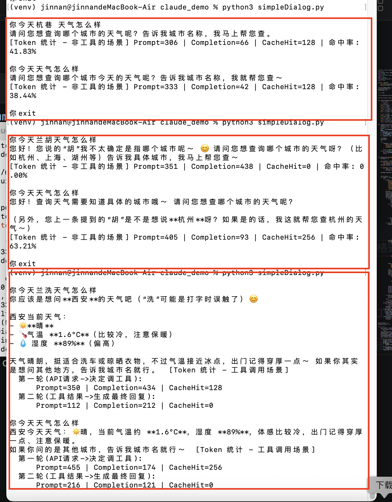

### KV cache缓存约束

目前多家厂商采用的是best-effect策略，有个最低token数的限制（tokens门槛）+落盘秒级+块对齐的限制。

- best-effort（尽力而为）—— 命中不是承诺
 - 含义：厂商在协议层面不保证 100% 命中。它只承诺"只要前缀一致，我会尽力去命中"，但命中与否受很多它内部的因素影响。
 - 为什么会落空：
  - 缓存放在 GPU 显存里，显存有限，老缓存会被驱逐（LRU）；
  - 请求被负载均衡打到不同副本/机房，缓存不共享时这一轮就没存上；
  - 缓存有TTL（生存时间），超时自动清空（DeepSeek 是几小时到几天，OpenAI/Anthropic 默认只有 5–10 分钟）。
- 64-tokens最小缓存单元的限制：
 - 因为建缓存本身有成本，要切块，要落盘，要占显存和磁盘，所以要设置个下限；
- 落盘秒级的延迟：
 - 上一轮算出来的 KV Cache 需要时间写入到共享缓存存储，这个写入是秒级的。如果你两轮请求间隔太短（毫秒级连发），下一轮发起时，上一轮的结果还没落盘，于是这一轮命中不了。
- 块对齐：
 - 缓存是按固定大小的块切分和存储的，命中的长度必须是整块的倍数，而不是任意一个token边界就能停。

### 调用工具的token消耗

- 判断工具与生成参数的token消耗：大模型在决定是否调用工具以及提取参数时，本质上是在进行**生成式推理**，所以非常消耗token；
 - 决策成本：决定调用哪个tool；
 - 参数生成：决定调用参数后会输出一段包含工具名和参数的JSON字符串，生成这段JSON本身，就是按照输出token计费的。
- 任何请求中所有工具的完整定义JSON Schema会被注入到上下文中；

### 调用工具的纠错

- 最开始是没有任何纠错处理；
- 第二个对话是tool的description的修改，让其可以找自动纠正城市名称；
- 第三个是让大模型自己有纠错机制，将把JSON解析参数错误/调用方法名称为空/接口调用失败等作为信息传给大模型，而不是直接return；

这里处理是最基础的纠错机制，会引入下边几个问题：
- 连续多次用相同的错误参数调用工具，会陷入死循环，白白浪费token；
- 模型有时候会在JSON里编造不存在的参数或者类型不匹配；
- 模型健忘，上次踩过的坑下次还会踩。
